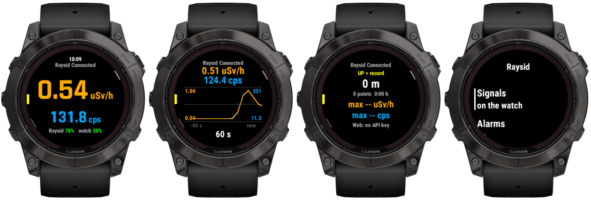
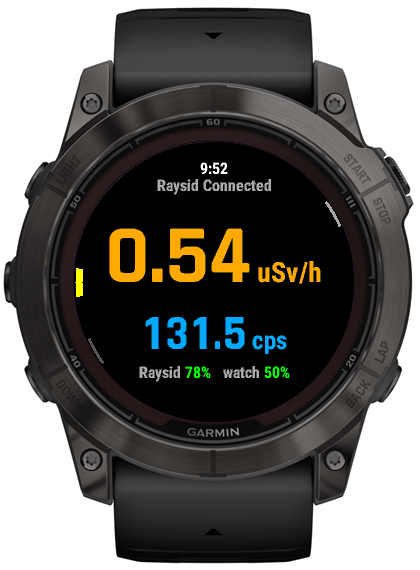
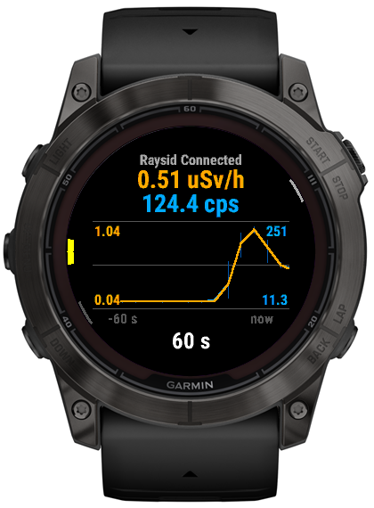
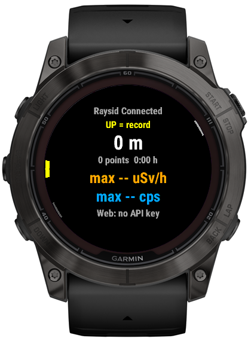
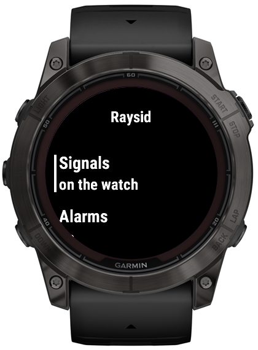
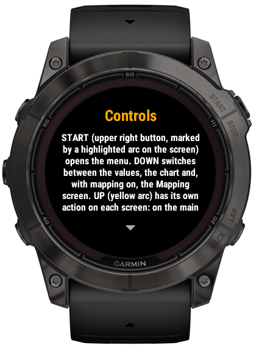

# Raysid Garmin

A Garmin watch app (Connect IQ) that connects to the **Raysid** dosimeter over Bluetooth and shows the dose rate and count rate right on your wrist. It has alarms, clicks, a chart and GPS radiation mapping, including uploading routes to the Czech website **[Žhavá místa](https://zhavamista.cz)**.

<p align="center"></p>
<p align="center"><sub>Rendered in the Connect IQ simulator (fēnix 7X Pro) with demo data, more in <a href="#screenshots">Screenshots</a>.</sub></p>

**Česky / Polski:** the user guide is also available in Czech ([docs/USER-GUIDE-CS.md](docs/USER-GUIDE-CS.md)) and Polish ([docs/USER-GUIDE-PL.md](docs/USER-GUIDE-PL.md)).

| | |
|---|---|
| Watch | Garmin fēnix 7X Pro (id `fenix7xpro`; developed and tested on fēnix 7X Pro Sapphire Solar), Forerunner 70 (`fr70`); other similar models as needed, see [Supported watches](#supported-watches) |
| Dosimeter | [Raysid](https://raysid.com) (BLE) |
| App languages | Czech, English, Polish |
| Version | 1.3 (the build number is shown in the app under Help > About) |
| License | [GPL-3.0-or-later](LICENSE) |

## Features

- **Measurement:** dose rate in µSv/h (orange) and cps (blue), battery of the Raysid and the watch. Values can be instantaneous, or averaged over a set time or number of measurements.
- **Chart** of the last 10, 20, 30 or 60 s with a separate scale for each quantity and shaded alarm sections.
- **Overload:** when the Raysid is overloaded (OVL), a blinking OVL is shown instead of the value. The Raysid reports it itself; the app also has a fallback estimate.
- **Signalling on the watch:** clicks, vibration and flashlight blinking according to cps, with a 1:N divider (1, 5, 10, 20, 50, 100, 250).
- **Watch alarms:**
  - dose limit, cps limit and rapid rise above background;
  - sound, vibration, screen flash, red flashlight and alarm duration are set separately.
- **Settings stored in the Raysid:** divider, clicks, dose and cps alarm, and linking the watch divider with the Raysid.
- **Mapping:**
  - a GPS point every 5–15 m (or a custom distance) with the average dose and cps since the previous point;
  - Mapping screen with statistics;
  - pause and resume recording;
  - full storage handling with point merging.
- **Upload to Žhavá místa:** in chunks of 50 points via the phone (Garmin Connect). The API key is entered directly on the watch.
- **Connection:** Raysid history, "Only chosen Raysid" and a choice of which unit to pick when more than one is in range.
- **Help on the watch** in three languages.

A detailed description of the controls is in the [user guide](docs/USER-GUIDE.md) ([Česky](docs/USER-GUIDE-CS.md), [Polski](docs/USER-GUIDE-PL.md)).

## Screenshots

From the Connect IQ simulator (fēnix 7X Pro, English UI). Bluetooth does not work in the simulator, so the values come from a demo build that walks past a hotspot.

| Main screen | Chart (60 s) | Mapping |
|:---:|:---:|:---:|
|  |  |  |
| **Menu** | **Help** | |
|  |  | |

## Installing on the watch

The app is not in the Connect IQ Store; it is installed manually (sideload):

1. Download the ready-made `Raysid.prg` file for your model. You will find it in [Releases](../../releases) or on the Žhavá místa website. Or build it yourself following [docs/BUILDING.md](docs/BUILDING.md).
2. Connect the watch to the computer with a USB cable. Note that some cables only charge.
   - Windows: the watch appears as a portable device.
   - macOS: you need OpenMTP or Android File Transfer.
   - Linux: MTP, for example via the KDE file manager (kio-extras) or `mtp-tools`.
3. Copy `Raysid.prg` into the `GARMIN/APPS` folder.
4. Disconnect the watch. The "Raysid" app appears in the app list.
5. Turn on the Raysid and close the Raysid app on your phone. The Raysid can have a Bluetooth connection with only one device.

To update, just overwrite the file. Settings and unsent points are kept if the new build is signed with the same developer key.

## Supported watches

The app is written for round button watches similar to the fēnix: START, BACK, UP, DOWN and LIGHT, Bluetooth LE and GPS. Each model needs the official device definition from the Garmin SDK Manager and a check of the on-screen layout, especially the button markers. The procedure is in [docs/BUILDING.md](docs/BUILDING.md#8-supporting-another-watch-model).

| Watch | Connect IQ id | Status |
|---|---|---|
| fēnix 7X Pro (Solar / Sapphire Solar) | `fenix7xpro` | tested on the watch |
| Forerunner 70 | `fr70` | checked in the simulator only; no flashlight, so its options are hidden |

The layout is computed from the display size, so models with the same resolution behave the same. One model per resolution was checked in the simulator (marked ✓); the others in its row share that resolution and were only compiled.

| Display | Models (Connect IQ ids) |
|---|---|
| 218 px MIP | `fr255s`✓ `fr255sm` |
| 240 px MIP | `fenix7s`✓ `fenix7spro` `fenix6spro` |
| 260 px MIP | `fenix7`✓ `fenix7pro` `fenix7pronowifi` `fenix6pro`✓ (Connect IQ 3.4) `fenix8solar47mm` `fenix9prosolar47mm` `fr255` `fr255m` `fr955` |
| 280 px MIP | `fenix7xpro` `fenix7x` `fenix7xpronowifi` `fenix6xpro` `fenix8solar51mm` `fenix9prosolar51mm` `enduro3` `enduro4` |
| 360 px AMOLED | `fr265s`✓ |
| 390 px AMOLED | `fr70`✓ `fr165` `fr165m` `fr57042mm` `epix2pro42mm` `instinct3amoled45mm` `marq2` `marq2aviator` |
| 416 px AMOLED | `epix2`✓ `epix2pro47mm` `fenix843mm` `fenix943mm` `fenix9pro43mm` `fenixe` `fr265` `instinct3amoled50mm` |
| 454 px AMOLED | `fenix847mm`✓ `fenix8pro47mm` `fenix947mm` `fenix9pro47mm` `epix2pro51mm` `fr57047mm` `fr965` `fr970` |
| 466 px AMOLED | `fenix9pro51mm`✓ |

Left out: fēnix 6 / 6S (non-Pro), Enduro (1st gen) and Instinct 3 Solar have only 128 kB of app memory; Venu has no UP/DOWN buttons; Instinct 2 has a monochrome display with a sub-window.

## Documentation

| File | For | Contents |
|---|---|---|
| [docs/USER-GUIDE.md](docs/USER-GUIDE.md) | user | controls and all features (same text as the help on the watch) |
| [docs/MENU.md](docs/MENU.md) | user | map of the whole menu as a tree (English, Czech, Polish) |
| [docs/USER-GUIDE-CS.md](docs/USER-GUIDE-CS.md), [docs/USER-GUIDE-PL.md](docs/USER-GUIDE-PL.md) | user | the user guide in Czech and Polish |
| [docs/BUILDING.md](docs/BUILDING.md) | developer | SDK, developer key, building, installing, logs, other models, releasing |
| [docs/ARCHITECTURE.md](docs/ARCHITECTURE.md) | developer | modules, data flow, timers, menu, stored data, alarms, OVL |
| [docs/RAYSID-PROTOCOL.md](docs/RAYSID-PROTOCOL.md) | developer | Raysid Bluetooth protocol, both the official and the sniffed part |
| [docs/MAPPING-AND-UPLOAD.md](docs/MAPPING-AND-UPLOAD.md) | developer | point recording, storage, merging, uploading to the website |
| [docs/zhavamista/endpoint-proposal.md](docs/zhavamista/endpoint-proposal.md) | website developer | Žhavá místa website interface for receiving routes |
| [AGENTS.md](AGENTS.md) | AI agent and human | how to work on the project: rules, watch limitations, conventions, checklist |
| [CHANGELOG.md](CHANGELOG.md) | everyone | version and build history |
| [docs/code-review-2026-10-14.md](docs/code-review-2026-10-14.md), [docs/ui-test-2026-10-15.md](docs/ui-test-2026-10-15.md) | developer | code review and UI test reports |

## Quick start for developers

```bash
# Connect IQ SDK and Java; fenix7xpro device definition from the SDK Manager
# your own developer key (never commit it):
openssl genrsa -out developer_key.pem 4096
openssl pkcs8 -topk8 -inform PEM -outform DER -in developer_key.pem -out developer_key.der -nocrypt

# compile check (strictest type checking)
monkeyc -d fenix7xpro -f monkey.jungle -o /tmp/t.prg -y developer_key.der -l 3 -w

# release build (increments the build number, writes source/BuildInfo.mc)
TOOLCHAIN=/path/to/toolchain bash build.sh fenix7xpro
```

Details are in [docs/BUILDING.md](docs/BUILDING.md).

## Privacy

- The app sends data only to the Žhavá místa website, and only when mapping is enabled and an API key is entered. The data are the position, time, dose and cps of route points.
- The API key is stored only on the watch.
- The debug log, if you turn it on, is written only to the watch.

## License and authors

Copyright © 2026 Vít Cenek and contributors ([AUTHORS.md](AUTHORS.md)). Code co-author: Claude (Anthropic).

This program is free software under the **GNU GPL version 3 or later** ([LICENSE](LICENSE)):
- You may freely use, copy and distribute it, including modified versions.
- When distributing, you must keep the authors and the license.
- Modified versions you distribute (including ready-made `.prg` files) must remain open source under the same license.

Raysid is a product of IN-NEW (Wrocław, Poland, [raysid.com](https://raysid.com)). Garmin, fēnix and Connect IQ are trademarks of Garmin Ltd. This project is not affiliated with them.
